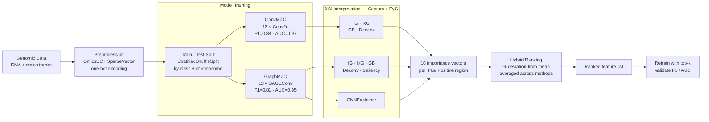

# OmiXAI

**OmiXAI** is an ensemble pipeline for gradient-based feature attribution in deep learning models trained on genomic and epigenomic data. It combines multiple attribution methods across CNN and GNN architectures and aggregates their outputs into a single ranked feature list via hybrid ranking.

Preprint: [bioRxiv 2025.04.28.651097](https://doi.org/10.1101/2025.04.28.651097)

---

## How it works



---

## Supported attribution methods

| Method | CNN | GNN | Library |
|--------|:---:|:---:|---------|
| Integrated Gradients (IG) | ✓ | ✓ | Captum |
| InputXGradient (IxG) | ✓ | ✓ | Captum |
| Guided Backpropagation (GB) | ✓ | ✓ | Captum |
| Deconvolution (Deconv) | ✓ | ✓ | Captum |
| Saliency | — | ✓ | Captum |
| GNNExplainer | — | ✓ | PyG |

---

## Data

Genomic data: [vladislareon/z_dna](https://github.com/vladislareon/z_dna)

Feature serialisation uses [SparseVector](https://github.com/Nazar1997/Sparse_vector) — clone it and add to `PYTHONPATH` (see cluster setup below).

---

## Installation

### Developers (any OS, CPU or GPU)

One command — everything comes from PyPI:

```bash
git clone https://github.com/aameliig/OmiXAI.git && cd OmiXAI
pip install -e .            # or: pip install -r requirements.txt
```

`torch-scatter`/`torch-sparse`/`torch-cluster` are **not** required: modern
PyTorch Geometric (≥2.3) provides native fallbacks for the layers OmiXAI uses.
After `pip install -e .` the package is importable anywhere (`import omixai`)
and the runner scripts work from any directory.

### Exact GPU reproduction of the paper (CUDA 12.1)

Only if you want the precise pinned build used for the paper:

```bash
pip install -e .
pip install -r requirements-gpu.txt \
    --extra-index-url https://download.pytorch.org/whl/cu121 \
    -f https://data.pyg.org/whl/torch-2.1.2+cu121.html
```

(torch must be present before the scatter/sparse wheels build, which is why this
path is pinned and index-specific.)

### Local MacBook M1/M2/M3 with uv (16 GB RAM)

The repository does not vendor the large dataset or trained weights. The
published [Scientific Reports article](https://www.nature.com/articles/s41598-026-62633-w)
points to the prepared-data repository
[`vladislareon/z_dna`](https://github.com/vladislareon/z_dna), the model/code
repository [`aameliig/OmiXAI`](https://github.com/aameliig/OmiXAI), and
[`hse-bioinflab/OmicsDC`](https://github.com/hse-bioinflab/OmicsDC) for track
collection. `z_dna` contains the expected `hg38_dna/`,
`hg38_zdna/sparse/`, and `hg38_features/sparse/` layout (1,946 omics pickle
tracks plus four DNA channels, i.e. 1,950 model features). Its sparse pickle
files require the small [`Sparse_vector`](https://github.com/vladislareon/Sparse_vector)
module on `PYTHONPATH`.

Download the prepared repository outside Git history, then inspect the label
pickle before downloading the very large DNA and omics blobs:

```bash
mkdir -p data_sources
git clone --filter=blob:none --no-checkout https://github.com/vladislareon/z_dna.git data_sources/z_dna
git clone --depth 1 https://github.com/vladislareon/Sparse_vector.git data_sources/Sparse_vector
git -C data_sources/z_dna checkout HEAD -- hg38_zdna/sparse/ZDNA_cousine.pkl
PYTHONPATH="$PWD/data_sources" uv run python - <<'PY'
import joblib
p = joblib.load("data_sources/z_dna/hg38_zdna/sparse/ZDNA_cousine.pkl")
print(len(p), sorted(p), sum(int((v.data != 0).sum()) for v in p.values()))
PY
```

The checked label file currently contains 25 chromosome vectors and 43,486
nonzero sparse segments; this is a useful integrity check before a full blob
checkout. For the bounded local workflow below, use real hg38 intervals, an
hg38 FASTA and coordinate-aligned omics BED or bedGraph tracks. `OmicsDC` is
the source named in the article for gathering ChIP-Atlas tracks.

```bash
cd OmiXAI
uv sync --python 3.12           # creates .venv and uv.lock
uv run python -c 'import torch; print(torch.__version__, torch.backends.mps.is_available())'
```

Create a CSV with one **real track** per row. BED files set a binary peak
indicator; bedGraph files supply a numeric signal divided by `scale`. All
coordinates must be zero-based half-open hg38; files may end in `.gz`.

```csv
name,path,kind,scale
CTCF,/path/to/CTCF.hg38.bed.gz,bed,1
H3K4me3,/path/to/H3K4me3.hg38.bedgraph.gz,bedgraph,1000
```

Prepare a small local sample and run the GNN workflow:

```bash
uv run python scripts/prepare_local_data.py \
  --fasta /path/to/hg38.fa \
  --labels-bed /path/to/kouzine.hg38.bed \
  --tracks-csv /path/to/tracks.csv \
  --positive 200 --negative 400 --max-features 50 \
  --output data/local_sample.npz
uv run python scripts/run_local.py --sample data/local_sample.npz \
  --device auto --batch-size 4 --epochs 5 --retrain-epochs 3 \
  --max-interpret 10 --top-k 10,25,50
```

If the FASTA has no `.fai`, the preparation script indexes it once in the
output directory. It reads one input track at a time and stores only the
selected 100 bp windows. `run_local.py` attempts MPS, probes a forward and
backward pass, and uses CPU if the MPS probe fails. It saves `checkpoint.pt`,
`scores.npz`, `ranking.csv`, `retrain.csv` and a manifest with the train/test
indices in `results/local/`. If memory is tight, use `--batch-size 1` and fewer
windows; use `--device cpu` to compare MPS with CPU. Positive and negative
windows are nonoverlapping, and the ranking uses training-set true positives
only. If the trained model finds none, increase `--epochs` or inspect class
balance before interpreting.

This is a bounded workflow for checking the complete sequence of stages on
real data. It does not reproduce the article's 1,950-feature experiment or
published performance numbers. Do not use the unrelated DNABERT model weights
as an OmiXAI GraphMZC checkpoint.

For a direct smoke run on the published pickle layout, download at least one
DNA chunk and a few complete feature pickles, then use:

```bash
PYTHONPATH="$PWD/data_sources" uv run python scripts/prepare_zdna_pickle_sample.py \
  --data-dir data_sources/z_dna --chrom chr22 --positive 100 --negative 200 \
  --output data/zdna_chr22_sample.npz
PYTHONPATH="$PWD/data_sources" uv run python scripts/run_local.py \
  --sample data/zdna_chr22_sample.npz --out-dir results/zdna_chr22 \
  --device auto --epochs 3 --retrain-epochs 2 --batch-size 8 \
  --max-interpret 3 --explainer-epochs 3 --top-k 1,2
```

### HSE HPC cluster

Nothing to pip-install — the module ships torch 2.1.2+cu121, torch_geometric and
captum:

```bash
module load Python/Google_Colab_GPU_2024
git clone -b reviewer-revision https://github.com/aameliig/OmiXAI.git ~/OmiXAI
# SparseVector is not a pip package — clone alongside the data if not present:
git clone https://github.com/Nazar1997/Sparse_vector.git ~/DNA/Sparse_vector
```

---

## Running on a SLURM cluster

```bash
cd ~/OmiXAI

# Step 1 — interpretation (~4–8 h, 1 GPU). Default METHOD=hybrid.
sbatch scripts/omixai.slurm

# Monitor
squeue -u $USER
tail -f logs/omixai_<JOBID>.out

# Step 2 — permutation feature importance (Reviewer 1 comparison).
# Same runner, PFI format. Parallelises across GPUs in pure Python.
METHOD=pfi sbatch scripts/omixai.slurm
#   or directly:
#   python scripts/run_interpret.py --model "$WEIGHTS" --data_dir "$DATA_DIR" \
#       --method pfi --out_dir results/pfi_dl/

# Step 3 — retrain with top-k features. Run after the matching interpretation.
# --k takes one value or a comma list ("all" = full feature set).
python scripts/run_retrain.py --data_dir "$DATA_DIR" \
    --ranking results/omixai_ranking.csv \
    --k 50,100,300,500,700,all                    # OmiXAI arm (sequential)
python scripts/run_retrain.py --data_dir "$DATA_DIR" \
    --pfi_scores results/pfi_dl/pfi_dl_scores.npy \
    --feature_names results/feature_names.json --k 50,100,300,500,700,all   # PFI arm

# Parallel across k (one process per GPU) — needs a multi-GPU allocation:
#   #SBATCH --gres=gpu:v100:2
# python scripts/run_retrain.py --data_dir "$DATA_DIR" \
#     --ranking results/omixai_ranking.csv --k 50,100,300,500,700,all --parallel
```

Results are written to `results/`:

| File | Contents |
|------|----------|
| `omixai_ranking.csv` | Hybrid-ranked feature list |
| `omixai_gnn_scores.npy` | Raw attribution scores per method |
| `feature_names.json` | Canonical feature order (shared by all scripts) |
| `pfi_dl/pfi_dl_scores.npy` | DL permutation importance scores |
| `retrain_omixai.csv` / `retrain_pfi.csv` | F1 / AUC at top-k per arm |

---

## Quick start (Python API)

```python
from omixai import OmiXAI

# Pass an already-trained model. model_type is auto-detected from layer types
# (Conv2d → cnn, MessagePassing → gnn). No feature counts are needed: the input
# width is read from the data, and the number of leading channels to skip is
# inferred as F - len(feature_names) at ranking time.
pipeline = OmiXAI(model=graph_model)

# Hybrid ensemble (default). Interpret train TPs only — test set stays sealed.
pipeline.interpret(train_loader, method="hybrid", width=100)
rankings = pipeline.rank_features(feature_names=feature_list)   # DNA channels dropped here
print(rankings.head(20))

# Permutation feature importance (GNN), parallel across GPUs in pure Python.
pipeline.interpret(train_loader, method="pfi", pfi_batch_size=64)
pfi_rank = pipeline.rank_features(feature_names=feature_list)
```

Non-genomic use: just pass `feature_names` covering every channel — then nothing
is skipped (`skip = F - len(feature_names) = 0`).

---

## Repository structure

```
OmiXAI/
├── omixai/
│   ├── __init__.py
│   ├── pipeline.py          # OmiXAI class — interpret(method=...) + rank_features()
│   ├── models/
│   │   ├── cnn.py           # ConvMZC
│   │   └── gnn.py           # GraphMZC
│   ├── data/
│   │   ├── dataset.py       # GenomicDataset + split (CNN)
│   │   ├── graph_dataset.py # GraphGenomicDataset + stratified_split_intervals (GNN)
│   │   └── genome.py        # genome loading + one-file joblib cache
│   ├── xai/
│   │   └── pfi.py           # batched, multi-GPU permutation feature importance
│   └── training/
│       ├── train_cnn.py     # training loop + metrics
│       ├── train_gnn.py
│       └── retrain.py       # retrain_topk: top-k feature-reduction experiment
├── scripts/                 # thin runners (no logic) + SLURM wrappers
│   ├── run_interpret.py     # interpretation runner (--method hybrid|pfi)
│   ├── run_retrain.py       # top-k retraining runner
│   ├── compare_old_new_ranking.py
│   ├── genome_cache.py      # back-compat shim → omixai.data.genome
│   └── omixai.slurm         # SLURM job (METHOD=hybrid|pfi)
├── notebooks/
├── results/
├── README.md
├── pyproject.toml          # package metadata + dependencies (pip install -e .)
└── requirements.txt
```

---

## Citation

```bibtex
@article{Alaeva2025omixai,
  author       = {Alaeva, Ameliia and Lapteva, Anna and Mikhaylovskaya, Natalya
                  and Malkov, Vladislav and Herbert, Alan
                  and Borevskiy, Andrey and Poptsova, Maria},
  title        = {OmiXAI: An Ensemble XAI Pipeline for Interpretable
                  Deep Learning in Omics Data},
  elocation-id = {2025.04.28.651097},
  year         = {2025},
  doi          = {10.1101/2025.04.28.651097},
  publisher    = {Cold Spring Harbor Laboratory},
  url          = {https://www.biorxiv.org/content/10.1101/2025.04.28.651097v1},
  eprint       = {https://www.biorxiv.org/content/10.1101/2025.04.28.651097v1.full.pdf},
  journal      = {bioRxiv}
}
```
